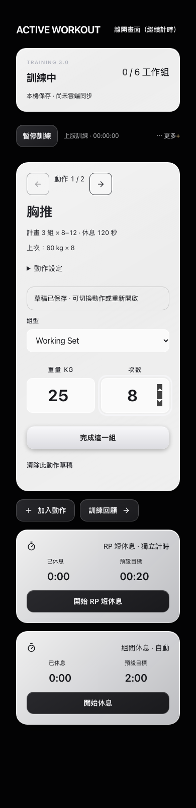
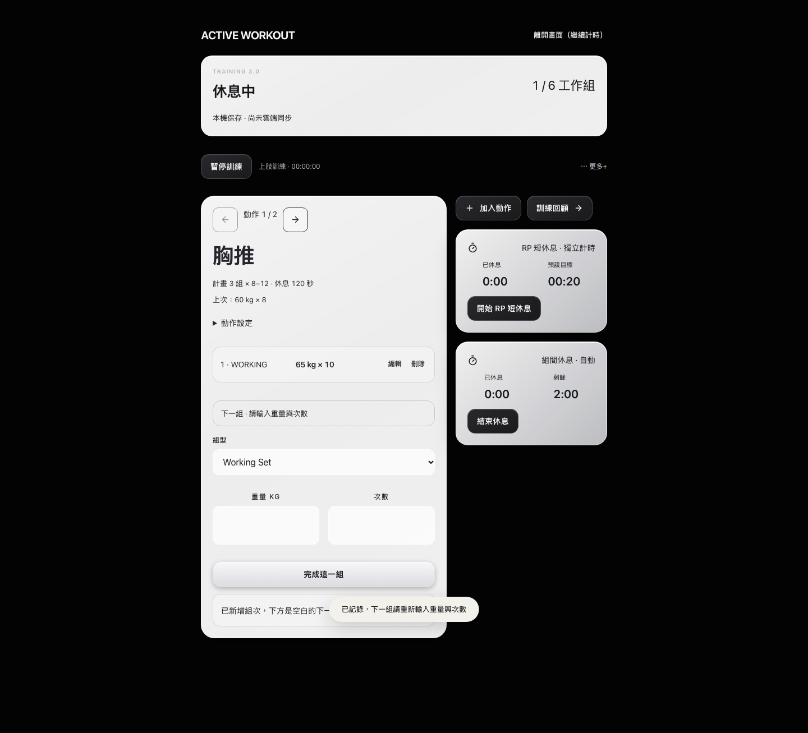
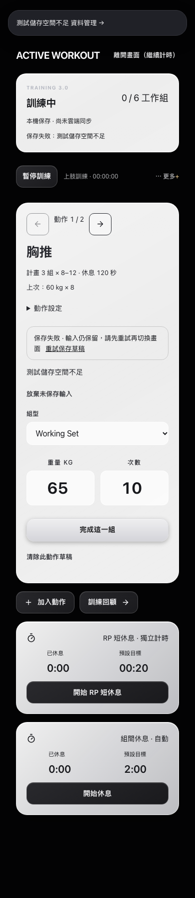
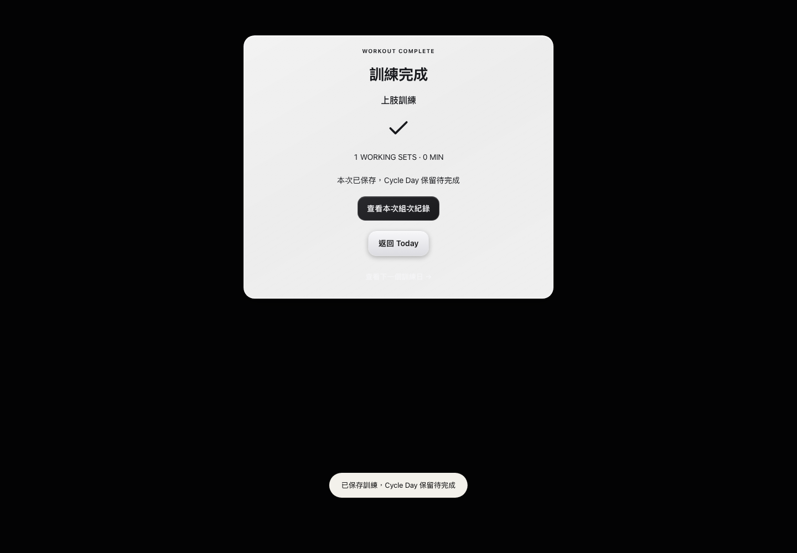

# Training 3.0 第一批：實作與驗收

日期：2026-10-21（Asia/Taipei） · **Draft only / 不合併、不部署**

## 基準與隔離

- main：`4667095c4996566492eb5470c902813e9f58fc8a`，工作結束前再次查詢遠端確認未變更。
- 既有 #43：仍為 open Draft、未合併；head `1c7d6b9728cd721e906eea349d660786c29cdd83`，主要是 Glass 基礎品質改善。
- 本分支 `training/active-workout-v3-20261021` 直接從 main 建立，未混入 #43。兩者修改同一 CI 測試清單，後續整合時須保留雙方的新增測試。
- 全部資料為 `tests/fixtures/training-v3.ts` 建立的合成資料。瀏覽器使用全新 Playwright context、測試帳號 `00000000-0000-4000-8000-000000000042`；Training 測試阻擋所有非 localhost 請求，未讀取或操作個人瀏覽器資料。
- 使用現有 Next.js 16.4 / React 19，已閱讀 AGENTS.md 及安裝版本的 `use-client`、`static-exports` 文件；保留靜態匯出與既有 Glass tokens。沒有新增套件或改動營養公式。

## 實際實作與驗收對照

| 項目 | 實作 | 驗證證據 |
| --- | --- | --- |
| Session / Segment 深層驗證 | 身分與狀態、數字範圍、整數次數、時間、重複 ID、RP/Drop 同動作父組、休息紀錄、草稿結構 | 單元負面案例；錯誤 JSON 匯入及損壞本機資料 E2E 均不覆寫 |
| Cycle 完整性 | Cycle/Day/queue/event 重複 ID 與不存在待完成日驗證；完成更新原 Session 所屬 Cycle | 完成 count/keep 單元與 E2E；新舊 Cycle 分離案例 |
| 組次 idempotency | 固定操作 ID、Session 提交 ID ledger；刪除／撤銷後仍保留已用 ID | 同一操作重試、重載後重試、同一事件連續 requestSubmit，僅一組 |
| SetDraft | 每個 Session 的每個動作獨立草稿，保存重量、次數、組型及父組；納入帳號備份 | 切換動作、重載、備份 roundtrip |
| 保存失敗／版本衝突 | 輸入保留、明確重試；未保存時阻止意外切換，可明確放棄未保存輸入；版本衝突後保留另一筆資料 | QuotaExceededError 故障注入、revision conflict E2E |
| 穩定歷史對應 | 優先 exerciseLibraryId；僅雙方均無 ID 的舊紀錄以名稱比對，不猜測異動 ID | 改名仍匹配、同名不同 ID 不合併、legacy fallback 單元測試 |
| Active Workout 介面 | 黑底白玻璃主卡、狀態列、桌面雙欄、手機大數字輸入、正常／草稿／休息／暫停／離線／錯誤狀態 | 375、390、430、768、1024、1440 px 截圖與操作；無橫向溢出 |
| 重量／次數／組型 | Working、Warm-up、Ramp-up、RP、Drop；HTML 與儲存邊界雙重驗證 | RP/Drop 真實 UI 與關聯資料驗收 |
| 計時／暫停恢復 | timestamp 計時保留；組次與自動休息同一筆原子保存，兩種休息互斥 | 暫停時間不增加、reload 復原、RP 切換關閉普通休息 |
| 編輯／撤銷 | 組次編輯與撤銷、刪除與復原、誤存撤銷；舊修改不能覆寫再次變更的組次 | UI 操作及原本 workout-sets 單元測試 |
| 完成確認／摘要 | 未達目標需明確決定是否計入 Cycle；草稿不計入組數；摘要顯示實際組數、時間、Cycle 結果與歷史連結 | count 與 keep 路徑、完成摘要截圖、資料落盤 |
| 真正備份／還原 | 經實際下載與上傳還原流程，不只呼叫序列化函式 | 讀取下載 JSON、還原前安全副本、還原後及重載後逐項核對 Session/Cycle |
| 舊版匯入 | 明確同意後複製至隔離帳號；保留原始 legacy snapshot、RIR 及未知附加欄位 | 原始 localStorage 字串前後相同；舊欄位無隱性轉換 |

## 測試結果

| 檢查 | 結果 |
| --- | --- |
| Typecheck | 通過 |
| Unit tests | **89 / 89 通過**（原有 68 + 新增 21） |
| Next.js production build + PWA | 通過 |
| Training 3.0 Playwright | **14 / 14 通過** |
| 現行 PR CI 測試集合 + Training 3.0 | **64 / 64 通過**，serial Chromium，30.9 秒 |
| 完整 repository Playwright | **64 通過 / 11 失敗，共 75**，保留失敗，不宣稱全部通過 |
| 未修改 main 對照 | 針對原失敗的四份測試檔：5 通過 / 13 失敗；13 個名稱與第一輪改版全庫失敗相同 |
| git diff --check | 通過 |
| iPhone Safari 真機 | **未測** |

完整測試失敗包含 10 項可在未修改 main 重現的舊 app / appearance / workspaces 測試，以及一次 Nutrition reload 停在帳號確認的間歇失敗。Nutrition 案例在最後 64 項 CI 集合重跑時通過，但不抹除先前失敗。原有 3 項 quick-log 測試沒有等畫面載入就 evaluateAll；本次補上等待 5 個項目出現，保留原尺寸／換行斷言，三項在最終集合通過。

- [最終 CI 集合輸出](evidence/training-v3/e2e-release-gate.log.txt)
- [完整 repository 執行與失敗](evidence/training-v3/e2e-final-all.log.txt)
- [未修改 main 對照](evidence/training-v3/e2e-baseline.log.txt)
- [單元測試](evidence/training-v3/unit-v3.log.txt)
- [建置輸出](evidence/training-v3/build-v3.log.txt)

先前在並行 baseline/build 驗證期間還遇過 auth-ready 時限失敗；最後使用乾淨 static build、單一 serial suite 的 64 項結果作為本次功能驗收，不將偶發失敗隱藏為無風險。

## 畫面驗收

- 已檢查手機與桌面的實際畫面。主要動作卡片使用既有 Glass surface / edge / blur tokens；只覆寫 Training 3.0 範圍，避免舊 workout 深色卡規則蓋掉新材質。
- 發現底部 sticky 完成按鈕會覆蓋數字輸入後，改為正常文件流，並加入「按鈕上緣不高於輸入下緣」的六寬度檢查。真機軟鍵盤／safe area 仍待測。
- 完成摘要取消裝飾角色，顯示真正保存的組數、時間與 Cycle 結果。
- Browser plugin 不在本次可用技能中，因此使用專案 Playwright；不是 iPhone Safari 實機，也不是雲端 OAuth / RLS 驗證。

## 未完成的發布驗收／風險

1. **iPhone Safari 真機未測**：沒有可用真機測試環境，`xcrun xctrace list devices` 回報缺少工具。軟鍵盤、VoiceOver、Dynamic Type、Safari 工具列、安全區與長時間背景恢復，不能以 Chromium 模擬取代。
2. **整個 repository E2E 尚非全綠**：保留完整執行及未修改 main 的對照紀錄。舊 app/appearance/workspaces 測試仍依賴舊登入／儲存與 UI 流程；未刪除或跳過這些失敗測試。
3. 本機保存並非雲端同步。離線驗收涵蓋已載入、已具測試快取身分的頁面；不宣稱離線首次 Google 登入或真實 OAuth/RLS 通過。
4. 新驗證會阻擋原本就損壞的舊快照，並保留原始資料供匯出；不會靜默修補或刪除。歷史事件允許保留已刪除計畫的參照。
5. 保留原本 localStorage revision 衝突保護，但 localStorage 不提供跨瀏覽器程序的交易鎖。未宣稱同時多視窗寫入具資料庫等級隔離；大型多年資料的低階 iPhone 輸入效能也尚未量測。
6. 舊紀錄缺穩定 ID 時不臆測對應到新 ID。若要完整回填，需另行人工核對動作名稱／器材，這次不改寫歷史。
7. #43 與本分支尚未合併；本 PR 不包含其修復。所有測試僅針對本分支相對 main，後續合併兩者後須再驗收。

## 重新執行

```sh
cd app-source
npm ci
npm run typecheck
npm test
npm run build
npm run test:e2e -- tests/e2e/training-v3.spec.ts --workers=1
npm run test:e2e -- --workers=1 --timeout=10000
```

正式 source、可重跑測試、截圖和測試輸出均隨此 Draft PR 提交。`publish-jfs-pages.yml` 未修改，未執行 pages:prepare、merge 或部署。

## 截圖





